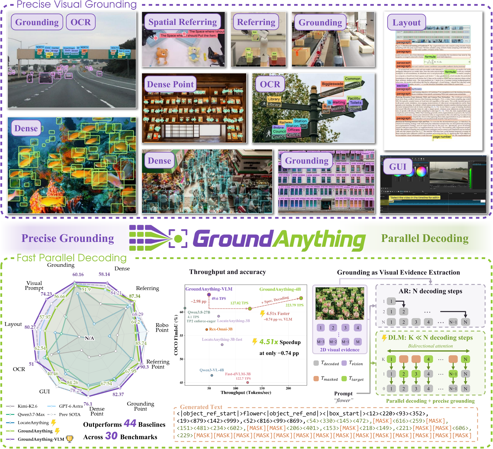
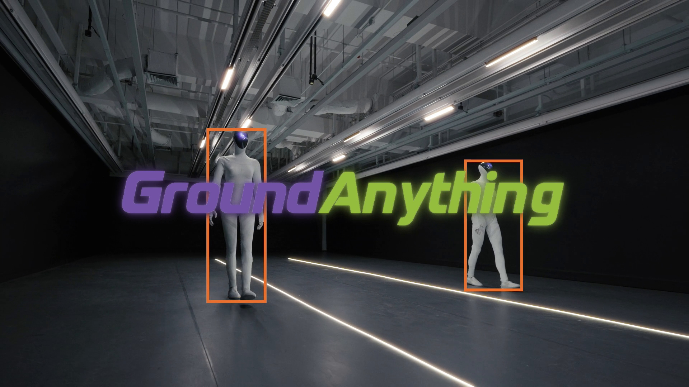

<h1 align="center"></h1>

<p align="center"><a href="README.md">English</a> | <strong>简体中文</strong></p>

<h3 align="center">以闪电般的速度兼顾并行解码与精准视觉定位</h3>

<p align="center">
  <a href="#highlights"></a>
  <a href="#quick-start"></a>
  <a href="#highlights"></a>
  <a href="#highlights"></a>
</p>

<p align="center">
  <a href="https://arxiv.org/abs/2609.39600"></a>
  <a href="https://huggingface.co/GroundingPI/GroundAnything"></a>
  <a href="https://huggingface.co/GroundingPI/GroundAnything-VLM"></a>
  <a href="https://www.modelscope.ai/models/GroundingPI/GroundAnything"></a>
  <a href="https://www.modelscope.ai/models/GroundingPI/GroundAnything-VLM"></a>
  <br />
  <a href="https://huggingface.co/spaces/GroundingPI/GroundAnything-VLM"></a>
  <a href="https://groundingpi.github.io/groundanything/"></a>
  <a href="https://github.com/groundingpi/GroundAnything"></a>
  <a href="https://huggingface.co/papers/2609.39600"></a>
</p>

<p align="center">
  <a href="#quick-start"></a>
  <a href="#vllm-deployment"></a>
  <a href="#deployment-options"></a>
  <a href="#batch-annotation"></a>
</p>

<p align="center"><a href="#demo">演示视频</a> · <a href="#quick-start">快速开始</a> · <a href="#documentation">文档</a> · <a href="#citation">引用</a></p>

<p align="center"></p>

<a id="news"></a>

## 📰 新闻

- **2026-10-14:** [GroundAnything](https://www.modelscope.ai/models/GroundingPI/GroundAnything) 和 [GroundAnything-VLM](https://www.modelscope.ai/models/GroundingPI/GroundAnything-VLM) 模型权重已上线 ModelScope。
- **2026-10-14:** GroundAnything 获得社区的广泛认可，在 [Hugging Face Daily Papers](https://huggingface.co/papers/2609.39600) 获得 **74 次 Upvote**。
- **2026-10-04:** 发布[项目主页](https://groundingpi.github.io/groundanything/)。
- **2026-10-03:** 发布源代码、部署与批量标注指南，以及完整评测流程。
- **2026-10-01:** 在 Hugging Face 发布 [GroundAnything](https://huggingface.co/GroundingPI/GroundAnything) 和 [GroundAnything-VLM](https://huggingface.co/GroundingPI/GroundAnything-VLM) 模型权重。
- **2026-09-30:** [GroundAnything 论文](https://arxiv.org/abs/2609.39600)已在 arXiv 发布。

<a id="contents"></a>

## 🧭 目录

[主要贡献](#highlights) · [演示](#demo) · [模型](#models) · [安装](#installation) · [部署方案](#deployment-options) · [快速开始](#quick-start) · [vLLM 部署](#vllm-deployment) · [批量标注](#batch-annotation) · [任务与输出格式](#tasks-and-output-format) · [方法与推理基础设施](#method-and-inference-infrastructure) · [评测](#evaluation) · [训练](#training) · [结果](#results) · [文档](#documentation) · [许可证](#license) · [引用](#citation) · [致谢](#acknowledgement)

<a id="highlights"></a>

## ✨ 主要贡献

- **将扩散模型用于广泛的视觉定位任务。** 我们提出 GroundAnything，一个兼顾精准定位与并行解码的 4B 基础模型，统一了多种视觉定位任务。模型依次经历视觉定位预训练、采用联合目标的自回归到扩散转换、有监督微调以及基于 GRPO 的强化学习。
- **在 4B 规模达到领先的视觉定位表现。** 在 30 个基准上，GroundAnything 超过了此前同等规模自回归模型的最佳总体表现，并优于规模更大的 Qwen3.7-Max。GroundAnything-VLM 在这一规模上取得新的最佳总体表现，并保持与 GPT-6 Astra 相当的竞争力。
- **系统性的加速研究。** 我们详细分析解码策略，与基于 MTP 的生成方式进行比较，并评估面向实际部署的逐步基础设施优化。

<a id="demo"></a>

## 🎬 演示

<p align="center"><a href="https://huggingface.co/GroundingPI/GroundAnything/resolve/d1819bbe01b5a16cebd67ecaca207d2696e3af59/assets/demo.mp4"></a></p>

[▶ 观看演示](https://huggingface.co/GroundingPI/GroundAnything/resolve/d1819bbe01b5a16cebd67ecaca207d2696e3af59/assets/demo.mp4)

[▶ 并行解码](https://huggingface.co/GroundingPI/GroundAnything/resolve/0f8e30894c3ca86378d01ae51ec69c217c78151b/assets/decoding.mp4)

<a id="models"></a>

## 🤗 模型

| 模型权重 | 生成方式 | 下载 | 评测模式 |
|:---|:---|:---|:---|
| **GroundAnything** | 熵引导扩散解码；可选自推测解码 | [DLM 权重](https://huggingface.co/GroundingPI/GroundAnything) | **GAM** |
| **GroundAnything-VLM** | 自回归生成 | [VLM 权重](https://huggingface.co/GroundingPI/GroundAnything-VLM) | **GAM** |

GroundAnything 的主要结果采用熵引导解码。GroundAnything-VLM 是独立的自回归模型权重。两者均使用 **GAM** 评测模式。

<a id="installation"></a>

## 🛠️ 安装

以下服务部署流程面向 **Linux x86_64 和 Python 3.12**。服务安装程序会安装仓库内的定制 **SGLang** 引擎及其锁定版本的依赖。随附的服务配置使用 Torch **2.9.1**、Transformers **5.5.4**、Triton **3.5.1**、sgl-kernel **0.3.20** 和 FlashInfer **0.5.3**。

```bash
git clone https://github.com/groundingpi/GroundAnything.git
cd GroundAnything
python3 -m pip install -r requirements.txt huggingface_hub
```

如果已有源码，先执行 `cd GroundAnything`。后续命令均在仓库根目录运行。

`requirements.txt` 安装轻量 HTTP 客户端、可视化工具和安装程序依赖。服务、训练与评测分别使用独立环境；仅执行 `pip install -r requirements.txt` 不会安装模型运行环境。客户端不加载权重，也无需安装 Torch。

**已测试的加速设备：** NVIDIA **B300, B200, H200, H800**，以及 **PPU**。请使用与各设备匹配的运行环境，安装详情见[环境配置](environments/README.md)。

<a id="deployment-options"></a>

## 🧩 部署方案

| 模型 | 后端 | 用途 | 指南 |
|:---|:---|:---|:---|
| GroundAnything (DLM) | **定制 SGLang** | 熵引导并行解码或自推测解码 | [DLM 快速开始](#quick-start) |
| GroundAnything-VLM | **定制 SGLang** | 使用现有服务进行自回归视觉定位 | [VLM 快速开始](#groundanything-vlm-autoregressive-decoding) |
| GroundAnything-VLM | **vLLM + Transformers 后端** | 另一种自回归服务部署方案 | [GPU / PPU 部署](docs/VLLM.md) |

请使用仓库内经过适配的引擎和启动程序。新增 vLLM 适配器**仅用于 GroundAnything-VLM**，已完成 CPU 层面的检查，尚待加速设备上的端到端验证。DLM 解码仍使用 SGLang。

所有方案均提供**兼容 OpenAI 的图像 + 文本 API**，输出结构化视觉定位结果。提示词覆盖指代表达、物体定位、文本区域定位、文档布局和点定位。提示词与坐标约定见[任务与输出格式](#tasks-and-output-format)；处理图像集合可从[批量标注](#batch-annotation)开始。

<a id="quick-start"></a>

## 🚀 快速开始

<a id="groundanything-entropy-guided-decoding"></a>

### ⚡ GroundAnything：熵引导解码

下载完整 DLM 发布包并启动服务：

```bash
hf download GroundingPI/GroundAnything --local-dir weights/dlm_bundle
python3 run.py setup serve
python3 run.py serve --decoder denoise
```

已发布的权重本身就是完整模型包，**无需**运行 `prepare-model`。随附的 SGLang 安装程序面向 **CUDA/GPU**；PPU 需要匹配的平台运行环境。

<a id="groundanything-self-speculative-decoding"></a>

### 🚀 GroundAnything：自推测解码

先停止已有 DLM 服务，再使用同一份权重运行：

```bash
python3 run.py serve --decoder speculative
```

<a id="groundanything-vlm-autoregressive-decoding"></a>

### 🔁 GroundAnything-VLM：自回归解码

下载独立的自回归模型权重。如果尚未准备服务环境，请先运行 `python3 run.py setup serve`。

```bash
hf download GroundingPI/GroundAnything-VLM --local-dir weights/vlm
python3 run.py serve --config configs/release/vlm_sglang.yaml
```

| 服务 | API 基础地址 | 模型 ID |
|:---|:---|:---|
| GroundAnything，两种 DLM 解码器均适用 | `http://127.0.0.1:8101/v1` | `groundinganything` |
| GroundAnything-VLM | `http://127.0.0.1:8102/v1` | `groundinganything-vlm` |

<a id="run-a-prediction"></a>

### 🎯 运行预测

保持服务运行。在第二个终端中使用已安装 `requirements.txt` 的环境，将 `your_image.jpg` 替换为自己的图片：

```python
from grounding_anything import GroundingAnything, visualize

client = GroundingAnything(
    base_url="http://127.0.0.1:8101/v1",
    model="groundinganything",
)

# Referring-expression grounding
result = client.predict("your_image.jpg", "the red car", task="bbox")
print(result.to_dict())
if result.valid:
    visualize("your_image.jpg", result).save("prediction.png")

# Point localization
point = client.predict(
    "your_image.jpg", "the center of the red car", task="point"
)
print(point.to_dict())
```

使用 **GroundAnything-VLM** 时，采用相同客户端，并设置 `base_url="http://127.0.0.1:8102/v1"` 和 `model="groundinganything-vlm"`。

命令行示例会保存 `result.json`，输出有效时还会保存 `prediction.png`。每次运行请选择新的输出目录：

```bash
python3 examples/predict.py \
  --image your_image.jpg --phrase "the red car" \
  --task bbox --output outputs/car
```

对于 VLM 服务，追加 `--base-url http://127.0.0.1:8102/v1 --model groundinganything-vlm`。

<details>
<summary>客户端参数与返回值</summary>

| 接口 | 参数 |
|:---|:---|
| `GroundingAnything(...)` | `base_url`、`model`、可选的 `api_key`、`timeout`（默认 120 秒） |
| `predict(...)` | 图片路径（JPEG、PNG、WebP）、指代表达、`task="bbox"` 或 `"point"`、`max_tokens`（默认 4096） |
| `visualize(...)` | 图片路径和有效结果；返回 Pillow 图像 |

`result.to_dict()` 包含 `task`、`predictions`、`raw_output`、`finish_reason`、`usage`、`parse_error` 和 `valid`。解析后的预测包含标签与 **0–999** 网格上的坐标，可视化程序会将坐标转换为图像像素。截断或格式错误的响应会返回 `valid=False`，并保留原始输出供检查。

</details>

更多用法见[示例](examples/README.md)和[客户端实现](grounding_anything/client.py)。

<a id="vllm-deployment"></a>

## ⚡ vLLM 部署

**GroundAnything-VLM** 还提供可选的 **vLLM Transformers 后端**适配器，用于自回归视觉定位。其专用 `.venv-vllm` 环境使用 **Linux x86_64 / Python 3.12**、预先安装且与加速设备兼容的 **Torch / vLLM 0.18.x** 运行环境，以及仓库内的 **Transformers 5.7.0 分支**。它与默认 SGLang 环境相互独立。

对于 **NVIDIA GPU**，在仓库根目录运行：

```bash
hf download GroundingPI/GroundAnything-VLM --local-dir weights/vlm
python3 run.py setup vllm --platform gpu
python3 run.py serve --engine vllm --platform gpu
```

对于 **PPU**，请在匹配的厂商运行环境镜像中执行，并将安装和服务启动命令中的 `gpu` 都替换为 `ppu`。若 `.venv-vllm` 已准备好，可跳过安装。选择其他新环境时，两条命令需使用相同的 `--venv`。

API 地址为 **`http://127.0.0.1:8102/v1`**，模型 ID 为 **`groundinganything-vlm`**。启动 vLLM 前，请停止占用该端口的 SGLang VLM 服务，或在 vLLM 发布配置中选择其他端口。在另一个终端检查服务是否就绪：

```bash
curl --fail http://127.0.0.1:8102/v1/models
```

默认配置为 **BF16、eager 执行、TP=1、一个活跃序列、16,384 个上下文 token，每个请求一张图片**。自定义请求必须包含 **`skip_special_tokens: false`** 和 **`spaces_between_special_tokens: false`**。评测使用 **GAM** 模式及 `configs/eval/vlm_vllm.yaml`。

GroundAnything 的 **DLM 熵引导与自推测解码器使用定制 SGLang 后端**；vLLM 方案仅接受独立的 VLM 权重。新增适配器已完成 CPU 层面的检查，尚待加速设备上的端到端验证。GPU/PPU 安装、完整图像请求及配置详情见 [vLLM 部署指南](docs/VLLM.md)。

<a id="batch-annotation"></a>

## 🗂️ 批量标注

通过 [JSONL 批处理指南](docs/BATCH_INFERENCE.md)，可为图像集合中的每张图片指定视觉定位提示词并生成标注。[批处理示例](examples/batch_predict.py)保存原始响应、解析后的坐标、完成状态及用量信息；使用相同输入与请求配置恢复任务时，可以跳过已成功的条目。

启动服务并准备输入清单后，运行：

```bash
python3 examples/batch_predict.py \
  --input requests.jsonl --output predictions.jsonl \
  --base-url http://127.0.0.1:8101/v1 --model groundinganything
```

随附服务配置使用**一个活跃序列**。这里的批处理是依次发送图片请求并持续保存结果。使用多个加速设备时，可将输入清单分配给独立的服务副本，每个工作进程使用独立输出文件。将预测用于标注前，请检查被截断或无效的结果。

<a id="tasks-and-output-format"></a>

## 🎯 任务与输出格式

模型接受一张图片和一条文本指令。便捷客户端的 `predict()` 方法会构造指代框和指代点提示词。其他任务请将相应提示词发送至服务中兼容 OpenAI 的 `/v1/chat/completions` 接口。

| 任务 | 提示词 |
|:---|:---|
| 物体 / 密集定位 | `Locate all the instances that match the following categories: car</c>person.` |
| 指代框定位 | `Locate the target referred to by the following description: the red car.` |
| 物体点定位 | `Point to: car</c>person.` |
| 指代点定位 | `Point to the target referred to by the following description: the red car.` |
| OCR | `OCR task detect all the text in box format.` |
| 文档布局 | `Detect all document layout elements that match the following categories: title</c>text.` |
| GUI 定位 | `Point to the UI element to click for the following instruction: open the settings menu.` |
| 视觉提示 | 使用原生空间 token 格式提供参考框，再请求定位相似物体。 |

<details>
<summary>视觉提示示例</summary>

```text
Given reference boxes <|box_start|><100><200><500><650><|box_end|> indicating one or more objects, find all similar objects in the image and output their bounding boxes.
```

</details>

所有已发布权重均采用 **GAM 空间 token 协议**，整数坐标范围为 **0 到 999**。边界框包含 `(x1, y1, x2, y2)`，点包含 `(x, y)`；目标不存在时用 `None` 表示。

```text
<|object_ref_start|>car<|object_ref_end|><|box_start|><100><200><500><650><|box_end|>
<|object_ref_start|>car center<|object_ref_end|><|box_start|><300><425><|box_end|>
<|object_ref_start|>absent object<|object_ref_end|><|box_start|>None<|box_end|>
```

请使用权重对应的分词器、处理器与对话模板。自定义 HTTP 请求应保持 `skip_special_tokens=false`，相邻坐标 token 之间不要添加空格，并将图片以 base64 data URI 放入 `image_url` 内容块，与文本提示词一同发送。

<a id="method-and-inference-infrastructure"></a>

## ⚙️ 方法与推理基础设施

两个版本共享 MoonViT-V2（Kimi K3）视觉编码器、多模态投影器及 Qwen3-4B 语言架构。

<p align="center"></p>


<a id="entropy-guided-decoding"></a>

### ⚡ 熵引导解码

发布配置采用**块大小 32**、**子块大小 4**和**熵阈值 0.8**。每个物理块包含一个已知锚点和 31 个被掩码的位置。

完成图像与查询的预填充后，GroundAnything 使用双向注意力对响应块去噪，并缓存已完成的前缀。子块从左到右处理。默认的*熵引导解码*会确定满足 $H_j\leq\tau$ 的掩码位置，其中 $H_j=-\sum_v p_j(v)\log p_j(v)$ 为未经修改的 token 分布的熵。如果没有位置满足条件，则确定熵最低的位置，以保证解码继续推进。已确定的 token 保持不变，随后通过一次因果前向计算构建已完成块的缓存，无需自回归验证。

<a id="self-speculative-decoding"></a>

### 🚀 自推测解码

共享权重还支持扩散草稿生成与因果验证，并接受最长匹配前缀。验证时仅接受与因果预测一致的最长连续草稿前缀；首次不一致即终止接受，后续偶然匹配的位置也会被丢弃。被拒绝后缀的状态会从缓存中移除。

自推测解码使用转换后模型的因果分支进行验证。精确的贪心验证保持的是该分支的输出，并不一定与独立训练的 GroundAnything-VLM 输出相同。

文档中的 `--decoder speculative` 方案采用**线性草稿生成和贪心验证**。

<p align="center"></p>


<a id="sglang-cuda-graph-and-fp8"></a>

### ⚙️ SGLang、CUDA Graph 与 FP8

实现从原生 PyTorch（Eager）逐步扩展到 SGLang（Eager）、CUDA Graph 回放和选择性 FP8 执行。去噪与因果前向计算分别保留各自的注意力与缓存语义。FP8 用于符合条件的语言模型线性运算，其余组件保持 BF16。这些优化降低执行开销或计算成本；量化仍可能改变 logits 和解码决策。

默认 DLM 服务采用 **BF16**、**Triton 注意力**、**eager 执行**、**一张 GPU**、**一个活跃请求**和**两个排队请求**。客户端并发请求会进入队列；更高服务并发需使用独立副本。

| 执行选项 | 用途 | 发布配置默认值 |
|:---|:---|:---|
| SGLang eager | 集成调度、注意力内核和缓存管理 | **启用** |
| CUDA Graph 回放 | 降低兼容的已捕获计算中的重复 GPU 启动开销 | **关闭**；论文中进行了研究 |
| 选择性 FP8 | 加速符合条件的语言模型线性运算 | **关闭**；默认推理仍使用 BF16 |

<details>
<summary>CUDA Graph 实现细节</summary>

可选实现会捕获固定形状的块计算。FlashInfer 路径使用持久化注意力掩码和设备端缓冲区更新；Triton 验证器为草稿与验证使用独立的元数据和输入缓冲区，同时共享模型参数与 KV 存储。支持的捕获场景为 B32、单请求，且不扩展张量、流水线或数据并行。预填充和不支持的形状使用 eager 执行。

图回放保持当前解码算法不变。选择性 FP8 是独立的数值配置，可能改变 logits 和 token 决策。论文在相同解码模式下比较这些基础设施优化。发布启动程序未提供 `--cuda-graph` 开关。

</details>

请使用仓库内的引擎和服务配置。仅安装上游 SGLang 不包含这些模型与解码适配。配置及原生参考方案见[推理指南](docs/INFERENCE.md)。

<a id="evaluation"></a>

## 📈 评测

GroundAnything 评测体系覆盖论文中的 **30 个基准**。[评测指南](eval/README.md)提供数据链接、路径配置、准确的 30 项任务选择、输入检查及完整评测流程。

共享评测器支持 **7 种模式**：

| 模式 | 支持的模型 |
|:---|:---|
| **`GAM`** | **GroundingPI, GroundAnything, GroundAnything-VLM** |
| `VLM` | 通用视觉语言基线模型 |
| `REXOMNI` | Rex-Omni |
| `LOCATEANYTHING` | LocateAnything |
| `GROUNDINGDINO` | 通过兼容服务运行的 GroundingDINO |
| `DLM` | 使用 GAM 协议的旧版扩散权重 |
| `RLV2` | 使用 GAM 协议的旧版强化学习权重 |

**三个已发布模型均使用 GAM 模式。** 先启动模型服务并配置数据路径，再运行：

```bash
python3 run.py setup eval
# Select the route matching the service that is already running.
python3 run.py eval --decoder denoise
python3 run.py eval --decoder speculative
python3 run.py eval --config configs/eval/vlm.yaml
```

随附配置为选定任务的 **8 样本冒烟测试**。完整的 30 基准评测请按照[全量评测指南](eval/README.md#full-suite)执行：选择论文对应的任务列表，设置 `limit: null`，并将结果写入新的 `run_id`。评测连接已有服务，不会启动服务或切换其解码器。

<a id="training"></a>

## 🏋️ 训练

训练使用独立环境。启动前请准备完整模型文件、分词器、已验证的输入缓存及清单。随附训练配置面向 **H800 级 CUDA GPU**，使用锁定版本的 CUDA 工具链和从源码构建的 FlashAttention。匹配的运行环境与依赖见[环境配置](environments/README.md)。

<a id="choose-a-training-stage"></a>

### 🧩 选择训练阶段

| 阶段 | 原生配置 | 启动配置 |
|:---|:---|:---|
| General | [`general.yaml`](configs/train/general.yaml) | [`general_train.yaml`](configs/release/general_train.yaml) |
| Specialist | [`specialist.yaml`](configs/train/specialist.yaml) | [`specialist_train.yaml`](configs/release/specialist_train.yaml) |
| SFT 1 | [`sft1.yaml`](configs/train/sft1.yaml) | [`sft1_train.yaml`](configs/release/sft1_train.yaml) |
| SFT 2 | [`sft2.yaml`](configs/train/sft2.yaml) | [`sft2_train.yaml`](configs/release/sft2_train.yaml) |

在原生配置中设置基座模型路径、匹配的分词器、已准备的输入、输出目录、批大小和序列长度。在启动配置中设置分布式拓扑与初始权重。**训练模式保持为 `DLM`；`GAM` 是评测模式。**

随附阶段模板面向 **8 节点 × 8 设备**。请根据集群调整 `nnodes`、`nproc_per_node`、`node_rank`、`master_addr` 和 `master_port`，并使运行时检查及 packing 清单与所选的 world size 和批大小一致。

```bash
python3 run.py setup train

# Inspect the configured training command before launching.
.venv-train/bin/python scripts/run.py configs/release/sft1_train.yaml --dry-run

# Run on each node with its corresponding launch configuration.
python3 run.py train --config configs/release/sft1_train.yaml
```

训练使用预先准备的缓存与清单进行采样、长度与图片检查、响应长度管理及 packing。启动前必须准备这些输入；仓库不提供通用的 JSONL 到训练缓存转换器。详见[数据准备](docs/DATA_PREPARATION.md)。

<a id="initialize-or-resume-a-checkpoint"></a>

### 🔄 初始化或恢复检查点

| 启动设置 | 行为 |
|:---|:---|
| `checkpoint.initial_dlm_checkpoint` | 为新阶段加载 DLM 权重，并使用新的优化器与调度器 |
| `checkpoint.resume_from_checkpoint` | 恢复包含优化器、调度器与训练状态的完整训练检查点 |

从这两项设置中选择一项。微调已发布 DLM 时，将完整的 `weights/dlm_bundle` 用作初始 DLM 权重，并将原生配置中的 `model.path` 指向匹配的自回归基座模型及其分词器。恢复 SFT 时，更新对应启动 YAML，再运行 `python3 run.py train --config ...`；顶层 `--resume` 快捷选项选择的是冒烟测试配置。

[训练指南](docs/TRAINING.md)还介绍了可选的强化学习。训练后，请按照[推理指南](docs/INFERENCE.md)导出新的完整推理模型包。已发布的 Hugging Face DLM 模型包可直接用于推理。

<a id="results"></a>

## 📊 结果

<p align="center"></p>


[论文与补充材料](https://arxiv.org/abs/2609.39600)。

<a id="documentation"></a>

## 📚 文档

| 指南 | 内容 |
|:---|:---|
| [环境配置](environments/README.md) | 各流程环境与平台前置要求 |
| [推理](docs/INFERENCE.md) | 服务、模型准备、配置及参考后端 |
| [vLLM 部署](docs/VLLM.md) | GPU / PPU 安装、容器起点及图像 API 请求 |
| [批量标注](docs/BATCH_INFERENCE.md) | 面向图像集合、支持断点恢复的 JSONL 预测 |
| [示例](examples/README.md) | 图像预测、JSON 输出与可视化 |
| [评测](eval/README.md) | 数据配置、论文基准评测体系、执行与结果 |
| [训练](docs/TRAINING.md) | 训练流程、分布式设置与检查点 |
| [数据准备](docs/DATA_PREPARATION.md) | 输入格式与本地准备要求 |
| [第三方来源](third_party/README.md) | 随附框架与来源信息 |

```text
GroundAnything/
├── run.py                  # Workflow launcher
├── grounding_anything/       # Lightweight HTTP client and visualization
├── configs/                # Serving, training, and evaluation recipes
├── infer/                  # Model services and decoding
├── train/                  # Training workflows
├── eval/                   # Tasks, prompts, requests, and metrics
├── models/                 # Model definitions
├── examples/               # Prediction examples
├── environments/           # Environment installers
└── docs/                   # Detailed guides
```

使用 `python3 run.py --help` 查看命令行接口。完整模型流程从源码目录运行；Python 包安装的是独立 HTTP 客户端。

<a id="license"></a>

## 📜 许可证

项目原创贡献采用 [Apache License 2.0](https://www.apache.org/licenses/LICENSE-2.0)，项目方不额外附加限制。此授权仅覆盖贡献作者拥有的权利。

第三方材料保留各自适用的许可证，包括适用于 Kimi 衍生材料及相关衍生作品的 [Kimi K3 License](licenses/Kimi-K3.txt)。这些上游条款仍然有效。组件归属见[第三方声明](THIRD_PARTY_NOTICES.md)，模型包的许可范围见[已发布模型的许可证](https://huggingface.co/GroundingPI/GroundAnything/blob/main/LICENSE)。

<a id="citation"></a>

## 📖 引用

如果本工作对您的研究有所帮助，请引用：

```bibtex
@misc{yu2026groundanythingreconcilingparalleldecoding,
  title = {{GroundAnything}: Reconciling Parallel Decoding with Precise Visual Grounding at Flash Speed},
  author = {Qize Yu and Lianrui Fan and Bowen Ping and Xini Ding and Zetian Song and Junbo Niu and Kaixuan Wang and Tianxing Chen and Yue Chen and Minghua He and Yuran Wang and Jie Huang and Haojun Zhang and Min Chen and Hao Li and Wenxuan Song and Ruihai Wu and Xianming Liu and Shilong Liu and Shuchang Zhou and Ping Luo and Shiyu Huang},
  year = {2026},
  eprint = {2609.39600},
  archivePrefix = {arXiv},
  primaryClass = {cs.CV},
  url = {https://arxiv.org/abs/2609.39600},
}
```

<a id="acknowledgement"></a>

## 🙏 致谢

感谢 [Rex-Omni](https://github.com/IDEA-Research/Rex-Omni) 和 [LocateAnything](https://github.com/NVlabs/Eagle/blob/main/Embodied/README.md) 团队分享研究成果与开源实现。
